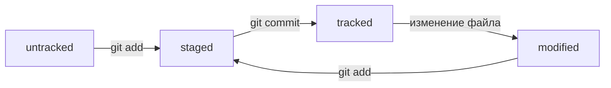

# Шпаргалка по Git

Конспект бесплатной части курса «Основы работы с Git» (Яндекс Практикум).

## 1. Командная строка

### Навигация
- `pwd` — показать текущую папку.
- `ls` — список файлов и папок; `ls -a` — вместе со скрытыми; `ls -la` — подробный список.
- `cd папка` — перейти в папку; `cd ..` — на уровень выше; `cd ~` — в домашнюю; `cd /` — в корень.

### Файлы и папки
- `touch file.txt` — создать файл (можно несколько через пробел).
- `mkdir dir` — создать папку; `mkdir -p a/b/c` — создать вложенные папки.
- `cp что куда` — скопировать; `mv что куда` — переместить или переименовать.
- `cat file.txt` — вывести содержимое текстового файла.
- `rm file.txt` — удалить файл; `rmdir dir` — удалить пустую папку; `rm -r dir` — удалить папку со всем содержимым.

### Полезное
- `cmd1 && cmd2` — выполнить команды по очереди.
- Стрелки `↑` и `↓` — история команд.
- `Tab` — автодополнение команд и путей.

## 2. Установка и настройка Git

```bash
git version                                   # проверить установку
git config --global user.name "Имя Фамилия"   # имя автора коммитов
git config --global user.email you@example.com
git config --list                             # посмотреть настройки
cat ~/.gitconfig                              # файл с глобальными настройками
```

## 3. Локальный репозиторий

```bash
git init          # сделать папку репозиторием
rm -rf .git       # «разгитить» папку (история будет потеряна!)
git status        # состояние репозитория
```

### Цикл коммита
```bash
git add file.txt      # подготовить файл к сохранению
git add --all         # подготовить все файлы
git add .             # подготовить текущую папку целиком
git commit -m "Сообщение коммита"   # зафиксировать изменения
git log               # история коммитов
```

Статусы файлов: `untracked` → `staged` (после `git add`) → `tracked`; изменённый отслеживаемый файл — `modified`.

## 4. GitHub и удалённый репозиторий

### SSH-ключи
```bash
ssh-keygen -t ed25519 -C "you@example.com"   # сгенерировать ключ
ls -a ~/.ssh                                 # проверить: id_ed25519 (приватный), id_ed25519.pub (публичный)
pbcopy < ~/.ssh/id_ed25519.pub               # macOS: скопировать публичный ключ
clip < ~/.ssh/id_ed25519.pub                 # Windows
ssh -T git@github.com                        # проверить привязку ключа
```
Публичный ключ (`.pub`) добавляется в GitHub: Settings → SSH and GPG keys → New SSH key. Приватный ключ никому не передавать.

### Связать и синхронизировать
```bash
git remote add origin git@github.com:USER/REPO.git   # привязать удалённый репозиторий
git remote -v                                         # проверить привязку
git push -u origin main                               # первая отправка (связывает ветки)
git push                                              # последующие отправки
```

Основная ветка называется `main` (в старых проектах — `master`).

## 5. README.md и Markdown

- Заголовки: `#`, `##`, `###`.
- Курсив `*текст*`, полужирный `**текст**`, зачёркнутый `~~текст~~`.
- Списки: `1.` нумерованный, `-` или `*` ненумерованный.
- Ссылка: `[текст](https://example.com "подсказка")`.
- Код: обратные кавычки `` `код` `` или блок из трёх кавычек с указанием языка.

## 6. Хеш коммита

- Хеш — уникальный идентификатор коммита: 40 символов (0–9, a–f), вычисляется алгоритмом SHA-1.
- Хеш одинаков для одних и тех же данных: одинаковые данные → одинаковый хеш, разные данные → разный хеш.
- Хеши коммитов хранятся в служебной папке `.git`.
- Для ссылки на коммит достаточно первых символов хеша (обычно 7–8), если они однозначно его определяют.

## 7. Лог коммитов: git log

```bash
git log            # полный лог: хеш, автор, дата, сообщение
git log --oneline  # сокращённый лог: короткий хеш и первая строка сообщения
```
- Коммиты выводятся от новых к старым.
- Выход из просмотра длинного лога — клавиша `q`.

## 8. HEAD

- `HEAD` — указатель на самый последний (текущий) коммит.
- Файл `.git/HEAD` содержит ссылку на текущую ветку (`ref: refs/heads/main`), а в `.git/refs/heads/main` лежит хеш последнего коммита.
- В командах слово `HEAD` можно использовать вместо хеша последнего коммита.

## 9. Статусы файлов в Git

- **untracked** — новый файл, Git его ещё не отслеживает.
- **tracked** — файл отслеживается (был добавлен через `git add` или уже закоммичен).
- **staged** — изменения подготовлены к коммиту (после `git add`).
- **modified** — файл изменён после последнего коммита, но ещё не добавлен в staged.

Схема словами: `untracked + git add = staged`, `staged + git commit = tracked`,
`tracked + изменение = modified`, `modified + git add = staged`.



`git status` показывает: `Untracked files`, `Changes to be committed` (staged),
`Changes not staged for commit` (modified).
